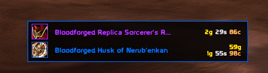
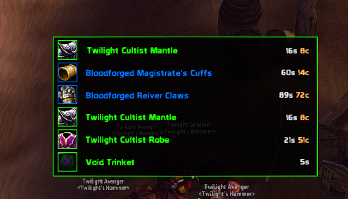

# CoA Loot Feed

Loot feed for WoW 3.3.5a (build 12340) / Ascension / Conquest of Azeroth. `## Interface: 30300`.

Rows show received items and money. Data comes from `CHAT_MSG_LOOT` and `CHAT_MSG_MONEY`; the loot window is not modified.

## Install

Copy the `CoALootFeed` folder into `Interface\AddOns\` and reload.

## Commands

| Command | Action |
|---|---|
| `/coalf` | Options panel |
| `/coalf alerts` | Minimap icon, sounds, custom price database |
| `/coalf timings` | Durations, price source, highlighting, coin style |
| `/coalf preview` | Demo rows |
| `/coalf move` | Unlock frame dragging |
| `/coalf reset` | Reset saved position |
| `/coalf money` | Money earned this session |
| `/coalf price <itemID or link> 12g34s56c` | Set a custom price (`0` removes it) |
| `/coalf prices` | List custom prices |

`/ulf` and `/ulf335` work as aliases.

## Options

- Frame: width, row height, max rows, border, background, font, grow direction, rarity borders.
- Text: name and details line, max name length, item icon size, outline.
- Timing: global duration or separate duration per item quality, fade in / fade out.
- Sounds: quality threshold, money threshold, test button. Uses client sound names.
- Prices: vendor price from `GetItemInfo`, auction price from Auctionator 2.6.8 (`Atr_GetAuctionPrice`) when installed, optional custom price. Source selector: Both / Vendor / Auction. Stack prices and price highlighting can be enabled. TSM is not supported.
- Coin style: `1g 85s 17c`, coin icons (`|T`), or client locale words.

SavedVariables: `ULF335DB` (settings and custom prices).

## Screenshots

## Notes

Clean-room implementation for 3.3.5a; no code from other loot-feed addons is used.
